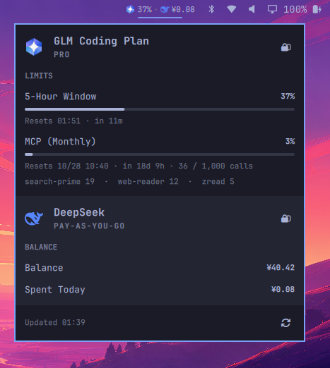

# coding-plan-usage

Omarchy bar widget showing coding-plan quota usage across LLM platforms.



- Bar: one icon + the binding (fullest) window percent, e.g. `󰹊 42%`
  (balance platforms show the amount, e.g. ` ¥110.00`)
- Popup (click): every enabled platform stacked top-to-bottom, each with
  per-window usage, progress bars, reset time + countdown, used/limit
  tokens, per-model breakdown, API key management
- Alarm coloring: < 70% normal, >= 70% accent, >= 90% urgent

## Install

```sh
omarchy plugin add https://github.com/xpader/omarchy-coding-plan-usage.git --enable
```

Then add the widget to your bar layout and set providers/refresh interval
in `~/.config/omarchy/shell.json` (see below).

## Structure

```
manifest.json          plugin manifest (bar-widget)
Panel.qml              all UI — bar pill + popup; platform-agnostic
Providers.qml          platform registry + aggregation (the abstraction seam)
Util.js                shared formatting helpers (node-testable)
providers/
  glm/
    GlmProvider.qml    GLM provider: key storage, refresh, fetch
    Model.js           GLM API response → normalized windows (node-testable)
  deepseek/
    DeepseekProvider.qml  DeepSeek balance provider
    Model.js              /user/balance parsing (node-testable)
```

Panel.qml only renders the **provider contract**; it never talks to a
platform API. Every provider must expose:

```
providerId / providerName / iconGlyph / keyLabel
state        "no-key" | "loading" | "ok" | "error"
statusText   error or transient note ("" when clean)
planLabel    plan/tier name from the platform ("" when unknown)
windows      [{ id, title, percent (0-100, -1 unknown), resetAtMs,
                 used, limit, details: [{ name, value }] }]
             balance-style entries use kind: "balance", valueText ("¥110.00")
             and no percent meter instead
headlinePercent   fullest window percent, -1 unknown
barLabel     bar-pill text replacing the percent for balance platforms
updatedAtMs / refreshing / hasApiKey
refresh() / setKey(key) / clearKey()
```

## Adding a platform

1. Create `providers/<id>/<Id>Provider.qml` implementing the contract
   (GlmProvider.qml is the reference).
2. Add parsing helpers in `providers/<id>/Model.js` (pure functions,
   export them for node tests).
3. Register it in `Providers.qml` → `registry`.

Toggle platforms from `~/.config/omarchy/shell.json`:

```json
{ "id": "pader.coding-plan-usage",
  "providers": { "glm": { "enabled": true } } }
```

## API keys

Stored per provider at
`~/.local/state/omarchy/coding-plan-usage/keys/<id>` (mode 600). Set or
remove them from the popup's API KEY section, or by hand:

```bash
umask 077 && mkdir -p ~/.local/state/omarchy/coding-plan-usage/keys
echo -n 'YOUR_KEY' > ~/.local/state/omarchy/coding-plan-usage/keys/glm
```

The key lives only on disk and in memory: requests go through QML's
built-in `XMLHttpRequest` (no curl subprocess, no key in any argv).

## GLM API

`GET https://open.bigmodel.cn/api/monitor/usage/quota/limit` with the
`Authorization: <apiKey>` header. `TOKENS_LIMIT` entries sorted by
`nextResetTime` are the rolling 5-hour window (first) and weekly window
(last); `TIME_LIMIT` is the monthly MCP allowance. Reference:
github.com/xpader/glm-usage.

## DeepSeek API

`GET https://api.deepseek.com/user/balance` with an
`Authorization: Bearer <key>` header. CNY `balance_infos` are summed for
the total; `granted_balance` / `topped_up_balance` show as the breakdown.
Reference: VSCode extension "DeepSeek Balance Display"
(shaoclouds.deepseek-balance-display).

## IPC

```
omarchy-shell pader.coding-plan-usage open|close|toggle|refresh|status
```

Panel keys: `j/k` scroll, `Enter`/`r` refresh, `e` open the key editor of
the first provider missing a key, `Esc` close.

## Notes

- Edit + `omarchy restart shell`: plugin hot-reload exists but may serve
  a cached document for inner files; a restart always applies cleanly.

## Remove

```sh
omarchy plugin remove pader.coding-plan-usage
```

Removal keeps your saved API keys on disk at
`~/.local/state/omarchy/coding-plan-usage/keys/`; delete that directory
if you no longer need them.

## License

[MIT](LICENSE) © Pader
